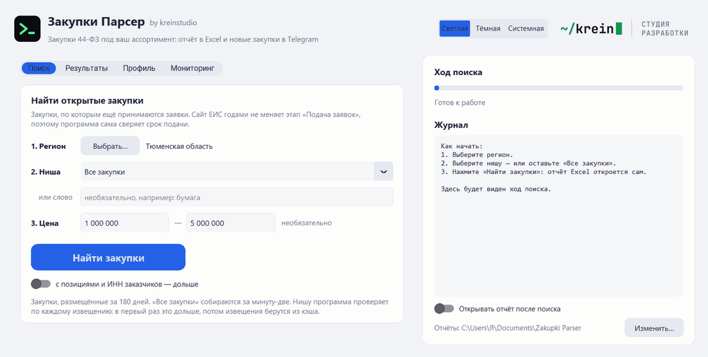
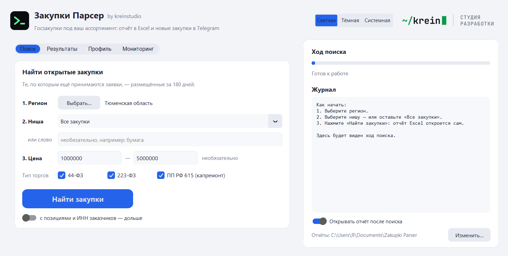
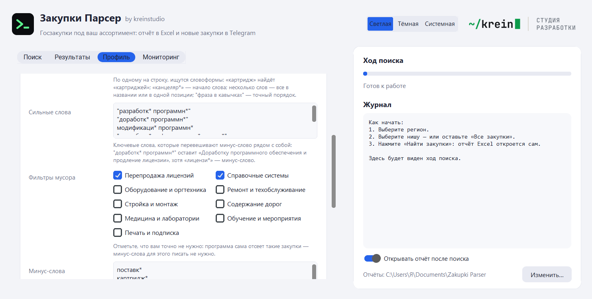
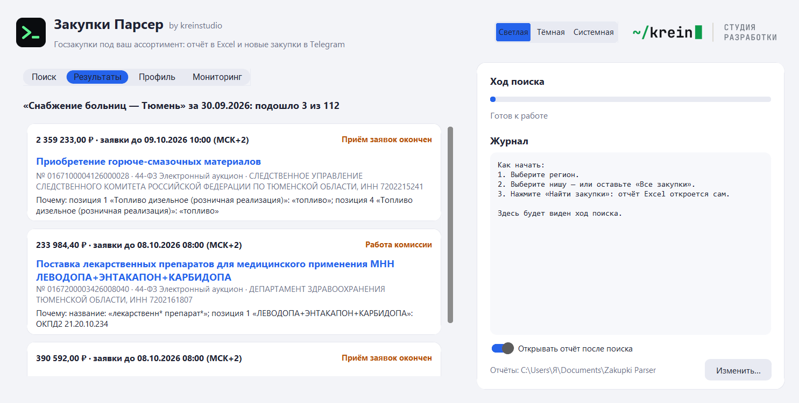
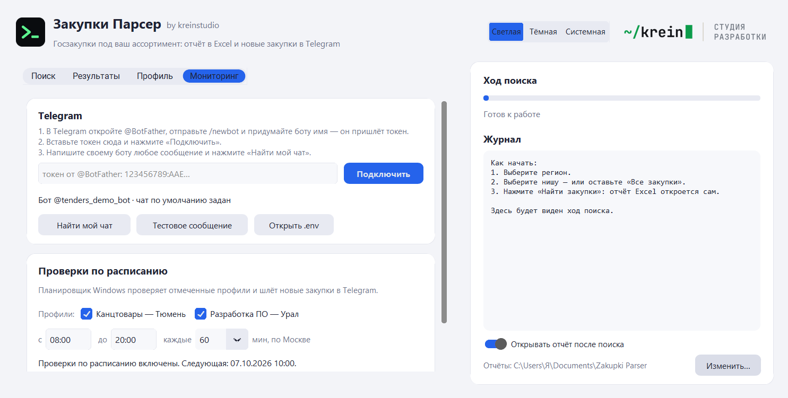

<a href="https://kreinstudio.ru/">
  <picture>
    <source media="(prefers-color-scheme: dark)" srcset="https://github.com/krein15/zakupki-parser/raw/main/assets/brand/logo-dark@2x.png">
    
  </picture>
</a>

## 44-ФЗ, 223-ФЗ и капремонт в одном поиске, ниша за 2 минуты

Закупки Парсер находит на [zakupki.gov.ru](https://zakupki.gov.ru) закупки, по которым ещё принимаются заявки,
и складывает их в Excel с объяснением, почему каждая подошла. Новые присылает в Telegram карточкой с кнопками.
Регистрация, токен и электронная подпись не нужны.

Главное в 0.10: к госзакупкам по 44-ФЗ добавились закупки госкомпаний по 223-ФЗ и капремонт по ПП РФ 615, а поиск
по нише стал в разы быстрее. Тюменская область, 1–5 млн ₽, 7 ноября: из 202 открытых закупок 140 по 44-ФЗ,
50 по 223-ФЗ и 12 по капремонту — раньше программа видела только первые 140.

### Что нового

- **223-ФЗ и ПП РФ 615 рядом с 44-ФЗ.** 223-ФЗ — это госкомпании и их «дочки», ПП РФ 615 — капремонт
  многоквартирных домов. Всё, что программа умеет для 44-ФЗ, работает и для них: выгрузка открытых, профили,
  мониторинг, профиль по примерам. На вкладке «Поиск» — галочки «Тип торгов», в профиле — в «Дополнительно».
  В отчётах Excel тип торгов стоит отдельной колонкой: фильтром таблицы легко оставить один. В карточках окна
  и Telegram он написан перед способом закупки.
- **Сначала отбор, потом скачивание.** Раньше поиск по нише скачивал каждое открытое извещение региона.
  Теперь сайт сам находит закупки с кодами ОКПД2 ниши, остальные отбираются по словам в названии, и скачиваются
  только отобранные. IT-услуги по Тюменской и Свердловской областям, любая цена, первый запуск: из 998 открытых
  закупок скачано 25, подошло 14. Это 2 минуты вместо ~40.
- **Профиль по примерам закупок.** «Новый профиль…» → «По примерам закупок…»: вставьте 2–5 ссылок на закупки,
  которые вам подходят. Программа соберёт коды ОКПД2 их позиций, общие слова и регионы и покажет, в скольких
  примерах встретилось каждое. Слова подбирать не нужно, минус-слова — по вкусу.
- **Фильтры мусора галочками.** Минус-слова больше не обязательно писать самому. Девять готовых наборов:
  «Перепродажа лицензий», «Справочные системы», «Оборудование и оргтехника», «Ремонт и техобслуживание»,
  «Стройка и монтаж», «Содержание дорог», «Медицина и лаборатории», «Обучение и мероприятия», «Печать
  и подписка». Две первые галочки на словаре разработчика за месяц по Уралу убрали 41 закупку из 155:
  перепродажу лицензий, сертификаты активации, «КонсультантПлюс». Ни одной разработки среди них не было.
- **Telegram в три шага прямо в окне.** Вкладка «Мониторинг»: вставьте токен от @BotFather и нажмите
  «Подключить». Программа проверит токен у Telegram, сохранит его в `.env` и сразу вырежет из журналов.
  Ошибки объясняет понятным языком. Файл `.env` руками открывать не нужно.
- **Командная строка:** `fetch --law` и `export --law` — только выбранные типы торгов; `show` показывает и закупку
  223-ФЗ по одному номеру.

| Поиск | Профиль |
|---|---|
|  |  |
| **Результаты** | **Мониторинг** |
|  |  |

### Как начать

1. Скачайте **ZakupkiParser-0.10.0-windows.zip** ниже и распакуйте в любую папку. Python не нужен.
2. Запустите `ZakupkiParser.exe`. Windows может предупредить о неизвестном издателе (программа не подписана
   сертификатом): «Подробнее» → «Выполнить в любом случае».
3. Выберите регион и нишу, нажмите «Найти закупки». Отчёт Excel откроется сам и сохранится
   в `Документы\Zakupki Parser`.
4. Для Telegram: на вкладке «Мониторинг» вставьте токен бота от @BotFather, нажмите «Подключить», напишите
   своему боту, нажмите «Найти мой чат» и «Включить».

**Обновляетесь с 0.9?** Профили, отчёты и настройки остаются на месте. Учтите одно: профиль, в котором типы торгов
не заданы, теперь ищет все три — и мониторинг начнёт присылать закупки по 223-ФЗ и капремонту. Если нужен
только 44-ФЗ, снимите лишние галочки «Типы торгов» в «Дополнительно» профиля (в файле — `laws = ["44"]`).

Командная строка и все параметры — в [README](https://github.com/krein15/zakupki-parser#readme).

Под капотом: Python 3.13, customtkinter, lxml, pymorphy3, openpyxl, Pillow; 403 теста на сохранённых страницах ЕИС
и обезличенных извещениях, проверка в GitHub Actions.
