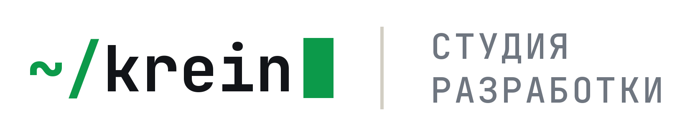

<a href="https://kreinstudio.ru/">
  <picture>
    <source media="(prefers-color-scheme: dark)" srcset="https://github.com/krein15/zakupki-parser/raw/main/assets/brand/logo-dark@2x.png">
    
  </picture>
</a>

## «Не моё» учит профиль

Закупки Парсер находит на [zakupki.gov.ru](https://zakupki.gov.ru) закупки по 44-ФЗ, 223-ФЗ и капремонту, по которым
ещё принимаются заявки, складывает их в Excel и присылает новые в Telegram карточкой с кнопками «✅ Беру»
и «❌ Не моё». Регистрация, токен и электронная подпись не нужны.

Главное в 0.11: кнопка «Не моё» больше не просто считает точность. Бот сразу предлагает, что исключить, чтобы такие
закупки больше не приходили, и сам дописывает это в профиль. Минус-слова больше не нужно подбирать вслепую:
словарь доводится по ходу работы, одним нажатием на каждую лишнюю закупку.

```
❌ Не моё
Не присылать похожие в «Топливо — Тюмень»? Выберите, что исключить, — добавлю в профиль:
[Фильтр «Оборудование и оргтехника»]
[Минус-слово «техника»]

→ Готово: фильтр «Оборудование и оргтехника» — в профиле «Топливо — Тюмень». Закупки со словами этого фильтра
  в названии больше не придут.  [Отменить]
```

### Как бот выбирает, что предложить

- **Сначала фильтры мусора**, которые задевает название закупки, **потом существительные** из названия — до трёх
  вариантов.
- **Не предлагается то, что вам нужно:** слова самого профиля, слова закупок, отмеченных «Беру», общие слова вроде
  «поставка» или «применение». Фильтр, который задел бы слова вашей ниши, тоже не предлагается: профилю медицинских
  изделий бот не предложит «Медицина и лаборатории».
- **Только честные обещания.** Если в названии есть сильное слово, бот молчит: оно перевешивает любое минус-слово,
  и «больше не придут» было бы неправдой. Проверено на 3 229 закупках, подошедших 12 шаблонам ниш: каждое из 5 648
  предложений действительно отсеяло бы свою закупку.

### Аккуратно с профилем

- Файл профиля меняется на месте: переписывается только нужный список, ваши комментарии остаются. Если после
  изменения профиль не читается, файл остаётся как был. «Отменить» возвращает всё назад.
- Подсказки приходят только в ваш чат (чат по умолчанию из `.env`). Клиент своими кнопками профиль не меняет.
- Окно не затрёт правку бота. Если профиль был открыт в окне, пока вы нажимали кнопки в Telegram, «Сохранить»
  оставит добавленные ботом минус-слова и фильтры и напишет об этом в журнале.

Подсказки появляются у карточек, присланных уже версией 0.11: у старых программа не запоминала файл профиля.
Для кнопок нужен включённый бот — вкладка «Мониторинг», «Включить».

### Как начать

1. Скачайте **ZakupkiParser-0.11.0-windows.zip** ниже и распакуйте в любую папку. Python не нужен.
2. Запустите `ZakupkiParser.exe`. Windows может предупредить о неизвестном издателе (программа не подписана
   сертификатом): «Подробнее» → «Выполнить в любом случае».
3. Выберите регион и нишу, нажмите «Найти закупки». Отчёт Excel откроется сам и сохранится
   в `Документы\Zakupki Parser`.
4. Для Telegram: на вкладке «Мониторинг» вставьте токен бота от @BotFather, нажмите «Подключить», напишите
   своему боту, нажмите «Найти мой чат» и «Включить».

**Обновляетесь с 0.10?** Профили, отчёты и настройки остаются на месте: профили лежат
в `Документы\Zakupki Parser\profiles`, а не в папке программы.

Командная строка и все параметры — в [README](https://github.com/krein15/zakupki-parser#readme).

Под капотом: Python 3.13, customtkinter, lxml, pymorphy3, openpyxl, Pillow; 419 тестов на сохранённых страницах ЕИС
и обезличенных извещениях, проверка в GitHub Actions.
