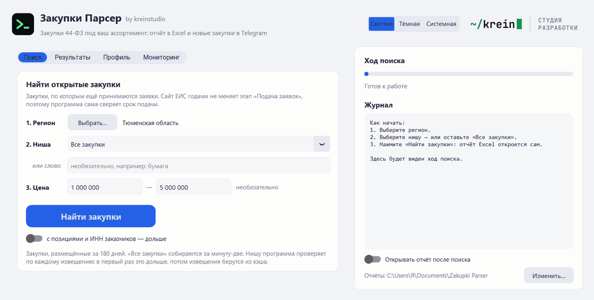
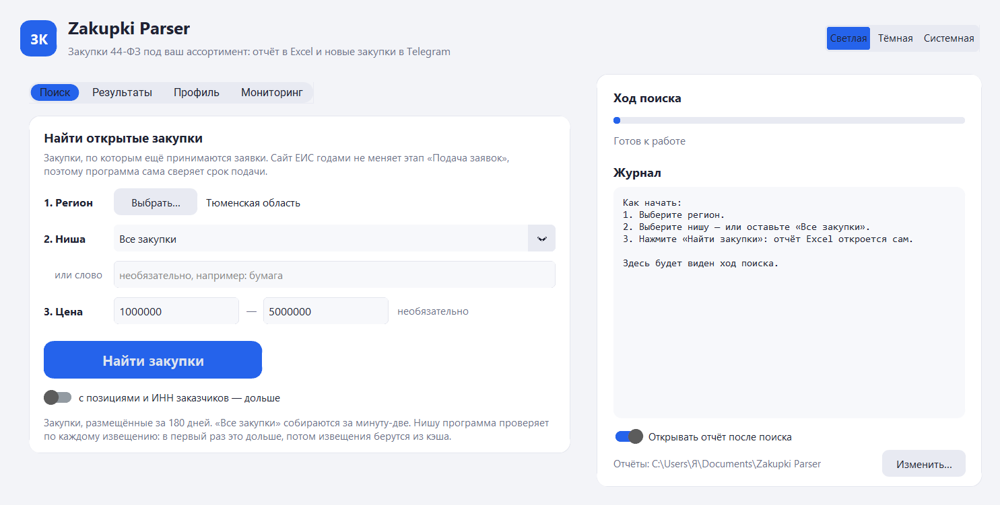
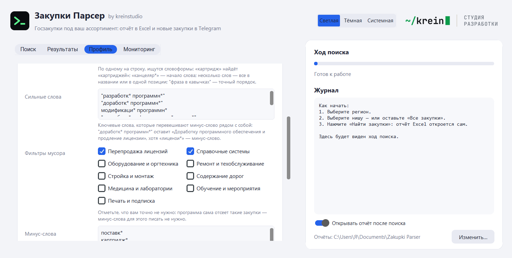
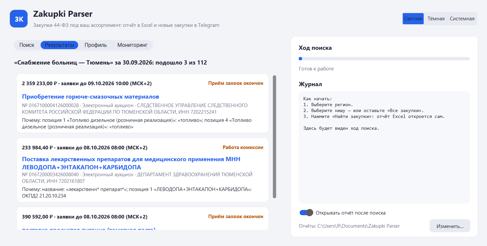
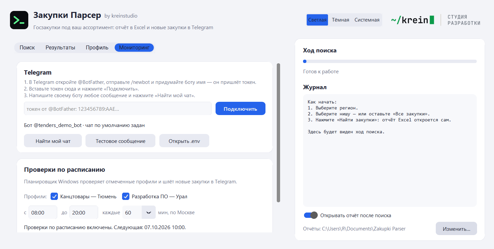

<a href="https://kreinstudio.ru/">
  <picture>
    <source media="(prefers-color-scheme: dark)" srcset="https://github.com/krein15/zakupki-parser/raw/main/assets/brand/logo-dark@2x.png">
    
  </picture>
</a>

## Открытые закупки 44-ФЗ в Excel — за три шага

Закупки Парсер находит на [zakupki.gov.ru](https://zakupki.gov.ru) закупки, по которым ещё принимаются заявки,
и складывает их в Excel с объяснением, почему каждая подошла. Новые — присылает в Telegram карточкой с кнопками.
Регистрация, токен и электронная подпись не нужны.

Главное в 0.9: программа стала понятной с первого взгляда. Регион, ниша, цена — «Найти закупки» — и отчёт
открывается сам. Ни слов, ни минус-слов, ни кодов знать не нужно.

### Что нового

- **Первый экран из трёх шагов.** Вкладка «Поиск»: 1. регион, 2. ниша, 3. цена — и одна кнопка. Ниша — готовый
  шаблон из 12 (канцтовары, лекарства, топливо, мебель, IT-услуги и другие) или ваш профиль; можно оставить
  «Все закупки». Регион не выбран — программа спросит его при первом нажатии и сразу продолжит. Тюменская область,
  1–5 млн ₽: 117 открытых закупок за 6 секунд.
- **Тонкая настройка — отдельно.** Вкладка «Профиль» собрала слова и коды в одном месте; заказчики, чат Telegram
  и этап свёрнуты в «Дополнительно» и раскрываются сами, если профиль ими пользуется. Справа в окне — только ход
  работы и готовый отчёт.
- **Сильные слова.** Ключевые слова, которые перевешивают минус-слово рядом с собой: «Доработка программного
  обеспечения и продление лицензии» больше не отсеивается минус-словом «лицензи*». В шаблоне IT семь таких фраз,
  проверенных на 12 тысячах извещений: они вернули настоящие разработки и не добавили ни одной продажи лицензий.
- **Огромные контракты не останавливают поиск.** Извещение, которое не скачивается (дорожные контракты с тысячами
  позиций), проверяется по названию из выдачи поиска, а после двух неудачных запусков пропускается на сутки;
  раньше три таких подряд останавливали весь запуск.
- **Срок у электронного магазина.** У закупок по ч. 12 ст. 93 срок подачи знает только площадка — ЕИС его нигде
  не публикует. Вместо «срок не указан» программа пишет «на площадке» и называет её.
- **Единицы лекарств словами:** «см[3*];^мл» из извещения стало «Кубический сантиметр; миллилитр» в отчёте
  и «мл» в карточке.

| Поиск | Профиль |
|---|---|
|  |  |
| **Результаты** | **Мониторинг** |
|  |  |

### Что умеет

- **Только открытые закупки.** Сайт ЕИС годами держит этап «Подача заявок» у закрытых закупок: в Тюменской
  области на 1–5 млн ₽ из 855 таких 749 давно закрыты. Программа сама сверяет срок подачи.
- **Отбор как у человека, а не по одному слову.** Словоформы, коды ОКПД2 и КТРУ, проверка не только названия,
  но и каждой позиции. У каждой закупки — почему она подошла.
- **Карточка в Telegram:** цена, срок с кружком «сколько осталось», заказчик, что покупают, кнопки «✅ Беру»,
  «❌ Не моё», «Открыть в ЕИС»; по понедельникам — итоги недели с точностью отбора.
- **Аудит набора ключевых слов:** что найдено, сколько из этого мусор, какие подходящие закупки вы не видите
  и на какую сумму.
- **Надёжно:** протокол падения бота, без пропусков и повторов после выключенного компьютера, пауза 2,5 секунды
  между запросами к сайту, токен бота только в `.env` и вырезается из журналов.

### Как начать

1. Скачайте **ZakupkiParser-0.9.0-windows.zip** ниже и распакуйте в любую папку. Python не нужен.
2. Запустите `ZakupkiParser.exe`. Windows может предупредить о неизвестном издателе (программа не подписана
   сертификатом): «Подробнее» → «Выполнить в любом случае».
3. Выберите регион и нишу, нажмите «Найти закупки». Отчёт Excel откроется сам и сохранится
   в `Документы\Zakupki Parser`.
4. Для Telegram: создайте бота у @BotFather, вставьте токен в `.env` (кнопка «Открыть .env» на вкладке
   «Мониторинг»), напишите боту, нажмите «Найти мой чат» и «Включить».

Обновляетесь с 0.8? Профили, отчёты и настройки остаются на месте: папки не переименовывались.

Командная строка и все параметры — в [README](https://github.com/krein15/zakupki-parser#readme).

Под капотом: Python 3.13, customtkinter, lxml, pymorphy3, openpyxl, Pillow; 364 теста на сохранённых страницах ЕИС
и обезличенных извещениях, проверка в GitHub Actions.
